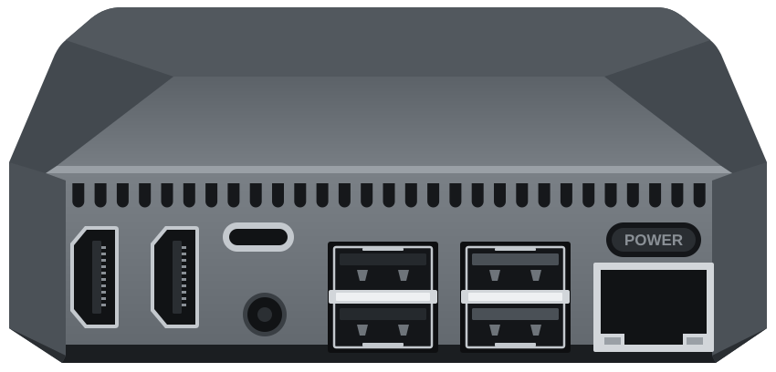

<h1 align="center">docker-argonone</h1>

<p align="center">
  <a href="https://github.com/wielorzeczownik/docker-argonone/actions/workflows/release.yml"><picture><source media="(prefers-color-scheme: dark)" srcset="https://img.shields.io/github/actions/workflow/status/wielorzeczownik/docker-argonone/release.yml?branch=master&style=flat-square&labelColor=2d333b&color=3fb950"/><source media="(prefers-color-scheme: light)" srcset="https://img.shields.io/github/actions/workflow/status/wielorzeczownik/docker-argonone/release.yml?branch=master&style=flat-square&color=2ea043"/></picture></a> <a href="https://github.com/wielorzeczownik/docker-argonone/releases/latest"><picture><source media="(prefers-color-scheme: dark)" srcset="https://img.shields.io/github/v/release/wielorzeczownik/docker-argonone?style=flat-square&labelColor=2d333b&color=3fb950"/><source media="(prefers-color-scheme: light)" srcset="https://img.shields.io/github/v/release/wielorzeczownik/docker-argonone?style=flat-square&color=2ea043"/></picture></a> <a href="https://hub.docker.com/r/wielorzeczownik/argonone"><picture><source media="(prefers-color-scheme: dark)" srcset="https://img.shields.io/docker/pulls/wielorzeczownik/argonone?style=flat-square&labelColor=2d333b&color=3fb950"/><source media="(prefers-color-scheme: light)" srcset="https://img.shields.io/docker/pulls/wielorzeczownik/argonone?style=flat-square&color=2ea043"/></picture></a> <a href="https://github.com/wielorzeczownik/docker-argonone/blob/master/LICENSE"><picture><source media="(prefers-color-scheme: dark)" srcset="https://img.shields.io/badge/License-MIT-3fb950?style=flat-square&labelColor=2d333b"/><source media="(prefers-color-scheme: light)" srcset="https://img.shields.io/badge/License-MIT-2ea043?style=flat-square"/></picture></a>
  <br/>
  
  <a href="https://hub.docker.com/r/wielorzeczownik/argonone"></a>
</p>

<p align="center">
  
</p>

Fan control for the [Argon ONE](https://argon40.com) case on Raspberry Pi 4 and 5, packed into a Docker image. It runs on any Linux distribution, so you don't need Raspberry Pi OS.

It's based on [johnmerchant/docker-argonone](https://github.com/johnmerchant/docker-argonone), with a few fixes to the upstream daemon, listed [below](#changes-from-upstream).

There are two images:

| Image                              | Access                 | Power button                    |
| ---------------------------------- | ---------------------- | ------------------------------- |
| `wielorzeczownik/argonone:latest`  | `--device` (I2C, GPIO) | doesn't shut down or reboot     |
| `wielorzeczownik/argonone:systemd` | `--privileged`         | shuts down and reboots the host |

Fan control works the same in both. Use `latest` unless you need the power button.

> [!WARNING]
> `--privileged` gives the container broad access to the host. Only use the `systemd` image if you actually want the button to work.

## Host setup

The daemon talks to the case over I2C, so turn it on before starting the container:

1. Add `dtparam=i2c_arm=on` to `/boot/firmware/config.txt` (Pi 5) or `/boot/config.txt` (Pi 4).
2. Load the module with `modprobe i2c-dev`.
3. To load it on every boot, add `i2c-dev` to `/etc/modules-load.d/i2c.conf`.

## Running

### Docker

```bash
curl -fsSL -o argononed.conf https://raw.githubusercontent.com/wielorzeczownik/docker-argonone/master/argononed.conf.example
docker run -d --name argonone --restart unless-stopped \
  --device /dev/i2c-1 --device /dev/gpiochip0 \
  -v "$PWD/argononed.conf:/etc/argononed.conf:ro" \
  wielorzeczownik/argonone:latest
```

For Docker Compose, also grab [docker-compose.example.yml](docker-compose.example.yml), save it as `docker-compose.yml` and run `docker compose up -d`.

On the Raspberry Pi 5 the GPIO lines sit on the RP1 chip, so pass `/dev/gpiochip4` instead of `/dev/gpiochip0`. The image detects the board on its own.

### Power button

Use [docker-compose.systemd.example.yml](docker-compose.systemd.example.yml), or add `--privileged` to the command above and change the tag to `:systemd`.

## Configuration

The image reads no environment variables. Everything comes from devices and the config file.

| Input                 | Required        | Default              | Meaning                                          |
| --------------------- | --------------- | -------------------- | ------------------------------------------------ |
| `/dev/i2c-1`          | yes             | -                    | I2C bus of the case, the daemon exits without it |
| `/dev/gpiochip0`      | for the button  | -                    | GPIO chip with the button line on the Pi 4       |
| `/dev/gpiochip4`      | for the button  | -                    | GPIO chip with the button line on the Pi 5       |
| `/etc/argononed.conf` | no              | `55=10 60=55 65=100` | fan curve, see [below](#fan-curve)               |
| `--privileged`        | `:systemd` only | off                  | lets the button shut down the host               |

### Fan curve

[argononed.conf.example](argononed.conf.example) maps temperature (°C) to fan speed (%). Each line means "from this temperature up, run at this speed":

```ini
55=10
60=55
65=100
```

Lines starting with `#` are ignored. Any speed from `0` to `100` works, `0` means the fan is off. After editing, run `docker restart argonone`.

## Changes from upstream

The patched files are in [patches/](patches), with every change described in [PATCHES.md](patches/PATCHES.md).

- Speeds below 25% are respected. Upstream spins the fan up to 100% first, which makes quiet profiles impossible.
- `argonone-fanconfig.sh` accepts 0 to 100%, upstream won't go below 30%.
- The daemon logs temperature and fan speed to `docker logs`.
- A failed I2C write no longer makes the daemon skip later speed changes.
- The daemon no longer exits after one loop when it runs without systemd.
